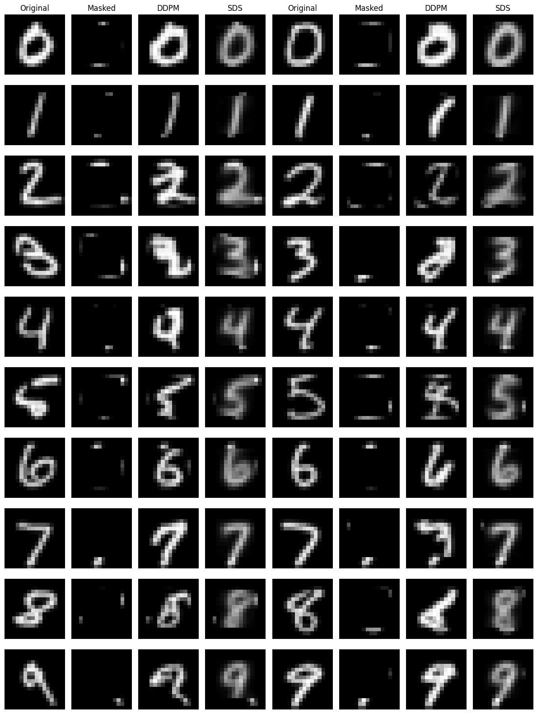
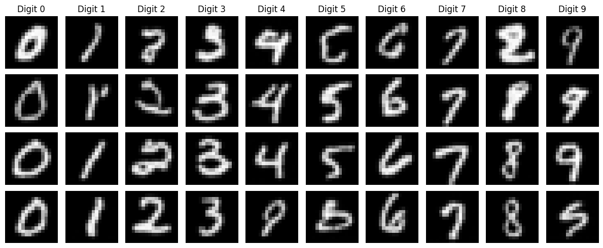
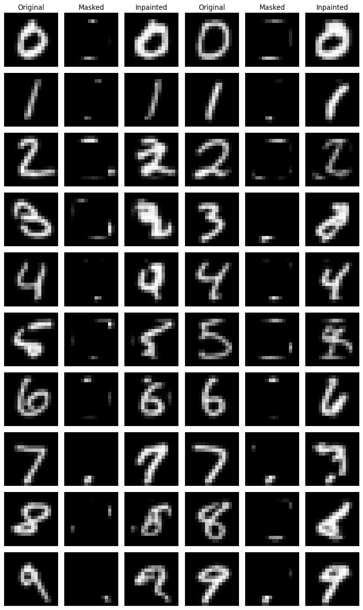

# Diffusion Inpainting: Sampling vs. Score Distillation

A compact, **from-scratch PyTorch implementation** of class-conditional denoising diffusion on 16×16 MNIST, comparing two approaches to masked image completion:

- **DDPM inpainting:** reverse diffusion with known-region constraints at each timestep.
- **Score Distillation Sampling (SDS):** direct pixel optimization guided by a frozen, class-conditional diffusion denoiser.

The two methods share the same learned prior but differ in how they use it: *iterative sampling* versus *gradient-based optimization*.

## Results

### DDPM vs. SDS



*Qualitative examples from the original experiments. DDPM often produced sharper digits; SDS tended to produce smoother completions. These observations are not a controlled quantitative comparison.*

### Class-conditional samples



### DDPM inpainting



## Method

**Backbone:** a small class-conditional U-Net with residual blocks, sinusoidal timestep embeddings, learned digit embeddings, and 16→8→16 spatial resolution. The model predicts Gaussian noise with a mean-squared-error objective.

**Diffusion:** 200 timesteps with a cosine noise schedule. The training images are resized to 16×16 and normalized to [-1, 1].

**DDPM inpainting:** at each reverse timestep, known pixels are replaced with a forward-noised version of the observation. A final projection restores observed pixels exactly. This is a *RePaint-style conditioning step*, not the full RePaint resampling schedule.

**SDS inpainting:** optimize missing image pixels with a frozen denoiser. Random timesteps provide a Monte Carlo estimate of the score-distillation direction; gradients are not propagated through the denoiser. Observed pixels remain fixed by construction. No classifier-free guidance is used, since the model was not trained with unconditional labels.

**Mask convention:** `1 = missing / generated`, `0 = observed / preserved`.

## Quick start

```bash
python -m venv .venv
source .venv/bin/activate
pip install -e '.[dev]'
pytest -q
```

Train the diffusion prior:

```bash
python scripts/train.py --epochs 22
```

Generate conditional samples and inpainting comparisons from the saved checkpoint:

```bash
python scripts/evaluate.py --checkpoint checkpoints/mnist_ddpm.pt --sds-steps 1000
```

New figures are written to `figures/generated/`. The committed images above are from earlier exploratory experiments, **not regenerated from the packaged code**. The packaged U-Net is a clean reimplementation and may not exactly reproduce those weights or images. Training is required because pretrained weights are not included.

## Experiments and limitations

The initial experiments explored class-conditioning changes, linear versus cosine noise schedules, DDIM versus ancestral DDPM sampling, and additional training epochs. The cosine schedule addresses an issue with the initial 200-step linear schedule retaining substantial signal at the final timestep. However, because conditioning, scheduling, and training duration were not independently ablated, the relative contribution of each change is **not established**. Short-step DDIM sampling was less reliable in the exploratory comparisons, and ancestral DDPM sampling was retained.

For inpainting, the qualitative results show recognisable digit completions with occasional distorted or ambiguous shapes. SDS outputs are often smoother, but this is not a general claim of DDPM superiority.

**Potential extensions:** controlled ablations, alternative denoiser architectures and conditioning mechanisms, challenging masks (irregular, larger, off-centre), quantitative reconstruction and class-consistency metrics, multiple random seeds, and alternative SDS weighting / timestep distributions.

## Project layout

```text
src/diffusion_inpainting/   # U-Net, noise schedule, sampling, DDPM inpainting, SDS
scripts/train.py           # train from scratch and save checkpoint
scripts/evaluate.py        # generate qualitative comparisons and preservation checks
tests/                     # shape, schedule, sampling and known-pixel tests
figures/                   # example results
```

## References

- Ho et al., *Denoising Diffusion Probabilistic Models*, NeurIPS 2020.
- Nichol & Dhariwal, *Improved Denoising Diffusion Probabilistic Models*, ICML 2021.
- Lugmayr et al., *RePaint: Inpainting using Denoising Diffusion Probabilistic Models*, CVPR 2022.
- Poole et al., *DreamFusion: Text-to-3D using 2D Diffusion*, ICLR 2023.

## Attribution and scope

This repository is an educational and research-oriented implementation of established methods. It does not claim to introduce DDPM, SDS, or RePaint. Before public distribution, confirm that any images or code originating from third-party assignment materials are permitted to be shared.
# diffusion-inpainting
